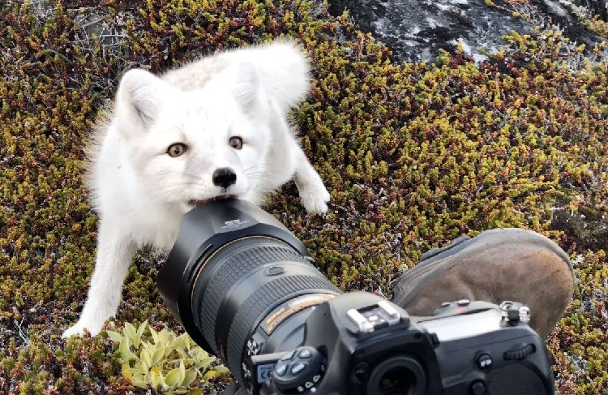

# VisionLab


<p align="center">
  
</p>


> A curated inventory of computer vision experiments, model reproductions, technical studies, and applied prototypes.

[](#getting-started)
[](#technology-stack)
[](#repository-inventory)
[](LICENSE)

## Overview

VisionLab is an experimental workspace for documenting small-scale computer vision studies, established-model reproductions, controlled benchmarks, and early-stage prototypes. Most projects are implemented in PyTorch and are intentionally compact in scope, with an emphasis on understanding model behavior, architectural ideas, training strategies, and practical vision pipelines.

The repository covers:

- Image classification and visual recognition
- Object detection and image segmentation
- Optical character recognition
- Vision-language learning
- CNN, Vision Transformer, and state-space architectures
- 3D vision and multi-view geometry
- Efficient and lightweight vision models
- Applied computer vision systems

Larger research projects, publication-related work, and complete systems are maintained as standalone repositories.

## Repository Inventory

| Collection | Scope |
| --- | --- |
| [`ImageClassification/`](ImageClassification/) | Model implementations, architecture benchmarks, transfer learning, and dataset-specific studies |
| [`ObjectDetection/`](ObjectDetection/) | Detector reproductions, architectural studies, pretrained inference, and shared utilities |
| [`OCR/`](OCR/) | CRNN-based sequence recognition and Tesseract-based document OCR pipelines |
| [`Segmentation/`](Segmentation/) | Semantic and instance segmentation experiments |
| [`Specialized/`](Specialized/) | Class-incremental learning, tracking, and vision-language research |
| [`APIs/`](APIs/) | Reusable local inference APIs for vision models |
| [`VisionProjects-Mid/`](VisionProjects-Mid/) | Medium-scope applied vision systems |
| [`VisionProjects-Tiny/`](VisionProjects-Tiny/) | Compact proofs of concept and implementation exercises |
| [`@Research-Robotics/`](@Research-Robotics/) | Research robotics workspace |

### Image Classification

#### Benchmarks and task studies

| Project | Research focus |
| --- | --- |
| [CIFAR Model Benchmark](ImageClassification/CIFAR-Model-Benchmark/) | Controlled, from-scratch comparison of CNN, Transformer, and state-space image classifiers |
| [Food-101 Classification](ImageClassification/VisionTask_Food101/) | Architecture experiments on the Food-101 dataset |
| [Imagenette Classification](ImageClassification/VisionTask_Imagenette/) | Architecture experiments and model research on Imagenette |
| [Vulpes Classification](ImageClassification/VisionTask_Vulpes/) | Fox-image classification experiments with ResNet and E-ConvNeXt variants |

#### Experimental series

| Project | Research focus |
| --- | --- |
| [CNN Transfer Learning and Fine-Tuning](ImageClassification/ExperimentalSeries/CNN-Transfer-Learning-Fine-Tuning/) | Comparison of transfer-learning and fine-tuning strategies |
| [Gabor Feature Machine Learning](ImageClassification/ExperimentalSeries/GaborFeatureML/) | Traditional feature extraction with Gabor filters, edge features, and machine-learning classifiers |
| [LeNet on MNIST](ImageClassification/ExperimentalSeries/LeNet_MNIST/) | LeNet training and evaluation on MNIST |

#### Model implementation archive

| Period | Implementations |
| --- | --- |
| 1998–2013 | [LeNet](ImageClassification/@Models/1998_LeNet/) · [AlexNet](ImageClassification/@Models/2012_AlexNet/) · [Network in Network](ImageClassification/@Models/2013_NiN/) |
| 2014 | [Inception V1](ImageClassification/@Models/2014_InceptionV1/) · [VGG](ImageClassification/@Models/2014_VGG/) |
| 2015 | [Highway Network](ImageClassification/@Models/2015_HighwayNetwork/) · [Inception V2](ImageClassification/@Models/2015_InceptionV2/) · [Inception V3](ImageClassification/@Models/2015_InceptionV3/) · [ResNet](ImageClassification/@Models/2015_ResNet/) |
| 2016 | [Inception-ResNet V2](ImageClassification/@Models/2016_Inception-ResNet-v2/) · [Inception V4](ImageClassification/@Models/2016_InceptionV4/) · [ResNet V2](ImageClassification/@Models/2016_ResNetV2/) · [ResNeXt](ImageClassification/@Models/2016_ResNeXt/) · [SqueezeNet](ImageClassification/@Models/2016_SqueezeNet/) · [Wide ResNet](ImageClassification/@Models/2016_WideResNet/) · [Xception](ImageClassification/@Models/2016_Xception/) |
| 2017 | [MobileNet V1](ImageClassification/@Models/2017_MobileNet-V1/) · [ShuffleNet V1](ImageClassification/@Models/2017_ShuffleNet-V1/) |
| 2020–2025 | [Vision Transformer](ImageClassification/@Models/2020_VisionTransformer/) · [Vision Mamba](ImageClassification/@Models/2024_VisionMamba/) · [E-ConvNeXt](ImageClassification/@Models/2025_E-ConvNeXt/) |
| Shared | [Model utilities](ImageClassification/@Models/Utils/) |

### Object Detection

| Project | Research focus |
| --- | --- |
| [R-CNN](ObjectDetection/2013_R-CNN/) | Region-proposal-based detection study |
| [Fast R-CNN](ObjectDetection/2014_FastRCNN/) | Fast R-CNN architecture study |
| [SPPNet](ObjectDetection/2014_SPPNet/) | Spatial pyramid pooling study |
| [Faster R-CNN](ObjectDetection/2015_FasterRCNN/) | Region proposal network study |
| [YOLOv1](ObjectDetection/2015_YOLOv1/) | First-generation YOLO study |
| [SSD](ObjectDetection/2016_SSD/) | Single Shot MultiBox Detector study |
| [YOLOv3](ObjectDetection/2018_YOLOv3/) | PyTorch YOLOv3 implementation |
| [YOLOv5-Nano](ObjectDetection/2020_YOLOv5-Nano/) | Independent, plain-PyTorch YOLOv5-Nano-style reproduction |
| [E-ConvNeXt + YOLO](ObjectDetection/2025_E-ConvNeXt-YOLO/) | E-ConvNeXt backbone with a lightweight YOLOv10-style PAFPN and dual-assignment head |
| [Pretrained YOLO](ObjectDetection/YOLO_pretrained/) | Pretrained YOLO inference experiments |
| [Detector Utilities](ObjectDetection/_DetectorUtils/) | Shared detection and visualization utilities |

### Optical Character Recognition

| Project | Research focus |
| --- | --- |
| [CRNN CAPTCHA Recognition](OCR/2015_CRNN/) | End-to-end CNN–BiLSTM–CTC sequence recognition in PyTorch |
| [ID Card Red-Text OCR](OCR/RED_TEXT_OCR_for_IDCard_tesseract/) | Detection, preprocessing, and Tesseract OCR for red text on identity cards |
| [Passport and Document-Card Red-Text OCR](OCR/RED_TEXT_OCR_for_Passport_tesseract/) | Red-text segmentation and OCR with support for vertical document text |

### Segmentation

| Project | Research focus |
| --- | --- |
| [FCN](Segmentation/2014_FCN/) | Fully convolutional network reference material |
| [Lightweight Segmentation on CamVid](Segmentation/LightweightSegmentation-CamVid/) | Fine-tuning LR-ASPP with MobileNetV3-Large for 11-class semantic segmentation |
| [Pretrained Mask R-CNN](Segmentation/_PretrainedModel/MaskRCNN_Pretrained/) | Pretrained instance-segmentation inference example |

### Specialized Research

| Project | Research focus |
| --- | --- |
| [Replay KLWA](Specialized/Class-Incremental-Learning/ReplayKLWA--A-Feasible-Few-Replay-CIL/) | Few-replay and exemplar-free class-incremental learning |
| [E-ConvNeXt + Light Transformer Captioning](Specialized/Vision-Language-Learning/2026_EConvNeXt-Transformer-Captioning/) | Multi-scale visual encoding and autoregressive Transformer decoding for Flickr8k and Flickr30k |
| [Tracking](Specialized/Tracking/) | Visual tracking workspace |

### APIs and Applied Projects

| Project | Research focus |
| --- | --- |
| [Grounding DINO Tiny Local API](APIs/API_GroundingDinoTiny/) | Reusable local Grounding DINO Tiny inference for paths, PIL images, and OpenCV frames |
| [LocateAnything Local API](APIs/API_LocateAnything/) | Project-local NVIDIA LocateAnything model storage and inference API |
| [License Plate Recognition](VisionProjects-Mid/License-Plate-Recognition/) | Haar Cascade and YOLOv11 plate detection with Tesseract OCR |
| [Smart Helmet Detector](VisionProjects-Mid/SmartHelmetDetector%5Bsecond%20iteration%5D/) | Second-iteration smart-helmet detection workspace |
| [Image Search Engine](VisionProjects-Tiny/ImageSearchEngine/) | Compact image-retrieval proof of concept |
| [Vision Communication Routing](VisionProjects-Tiny/VisionCommunicationRouting/) | Hackathon project for sensor-fusion-based vision communication routing and fire detection |

## Project Classification

Projects are classified by purpose rather than size alone.

| Label | Meaning |
| --- | --- |
| **Reproduction** | Implementation or reproduction of an established model or paper |
| **Experiment** | Controlled exploration of a model, dataset, or training strategy |
| **Benchmark** | Comparison of multiple methods, settings, or architectures |
| **Technical Study** | Focused investigation of a computer vision concept |
| **Prototype** | Early-stage proof of concept for a larger idea |
| **Applied System** | Practical computer vision pipeline or application |
| **Coursework** | Project originally developed for a course or academic assignment |

When a project uses status labels, they have the following meanings:

| Status | Meaning |
| --- | --- |
| **Complete** | Implementation and documentation are available |
| **In Progress** | Development or experimentation is ongoing |
| **Archived** | Retained for reference but no longer actively maintained |
| **Planned** | Project structure exists, but implementation has not started |

## Getting Started

Clone the repository:

```bash
git clone https://github.com/JiaenSuen/VisionLab.git
cd VisionLab
```

Each project manages its own dependencies and usage instructions. Enter the selected project directory, review its local README, and install its requirements when available:

```bash
cd ObjectDetection/2020_YOLOv5-Nano
pip install -r requirements.txt
```

To retrieve a single project without cloning the complete repository, copy its GitHub directory URL into [Download Directory](https://download-directory.github.io/).

## Technology Stack

Common tools used across the repository include:

- Python
- PyTorch and Torchvision
- OpenCV
- NumPy and Pandas
- Matplotlib
- Scikit-learn
- Hugging Face Transformers
- Jupyter Notebook

Dependencies vary by project. Refer to the relevant project directory for its environment configuration.

## Reproducibility Notes

- Projects vary in scope, maturity, and documentation depth.
- Results may differ with dataset versions, hardware, random seeds, and training configurations.
- Some projects are educational reproductions and are not presented as original research contributions.
- External datasets, pretrained models, papers, and third-party implementations remain subject to their respective licenses and terms of use.

## Author

**Jiaen Suen** — computer science student interested in computer vision, deep learning, efficient neural networks, and practical AI systems.

- GitHub: [@JiaenSuen](https://github.com/JiaenSuen)

## License

This repository is licensed under the [MIT License](LICENSE).
